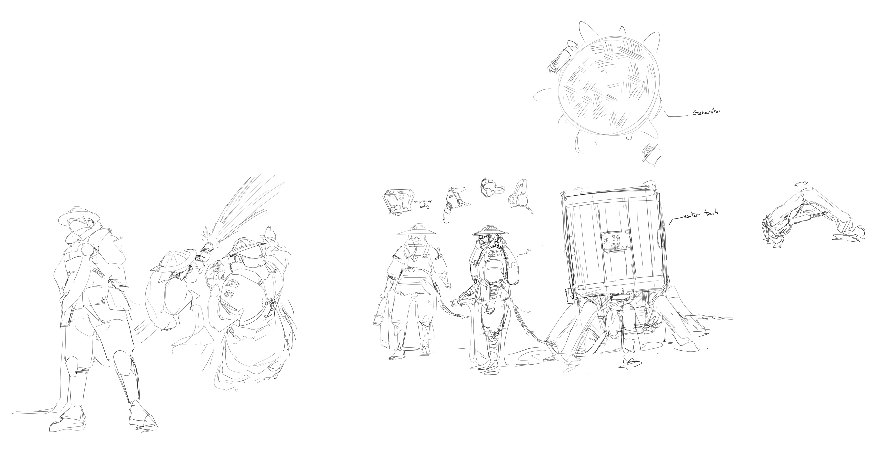

# Midori (Legacy)

Work was made then AI happened.. So I pivoted to vibe coding :/

At the end of the day this app was made because I needed it not for learning

It feels weird vibe coding and *cuck programming* is not really something I like but the result clearly shows how fast things get's done when using LLMs

This branch does not build. But everyting apart the legacy converter was handcrafted with love. I was planning to add multithreading so this is why this branch is a hot mess

I mean it still worked

